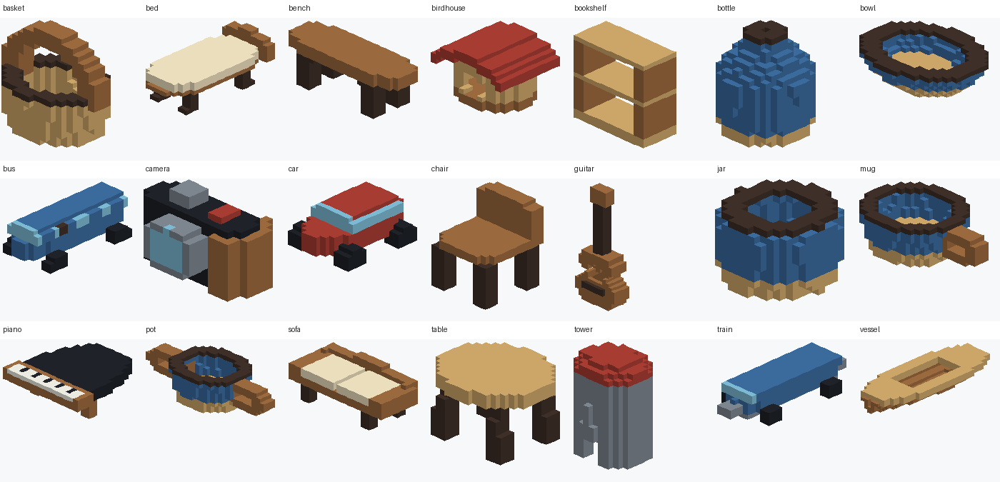

# BrickMore

## 最新：钢琴与桌子重拼结果（2026-10-13）

全部 A/B 钢琴、桌子 **7,620 个**模型已重新处理，几何通过 **7,485 个（98.23%）**：钢琴 3,807/3,810（99.92%），桌子 3,678/3,810（96.54%）。新增救回 5,464 个，原成功结果全部保留。完整模型与已修正遮挡的三维预览见 **[最新 Release](https://github.com/BuShiGeMenn/BrickMore/releases/tag/lego-piano-table-retile-7620-20261013-v1)**，详见 [统计、下载与核验](datasets/piano_table_retile_7620/README.md) 和 [12个真实预览样例](preview/piano_table_retile/index.html)。

本次预览采用逐像素深度测试，修正长砖的遮挡假象；独立检查全部 1,044,094 块砖未发现砖体重叠。原网格仍为48³、原颜色保留、体素改动≤2%。这是几何通过，物理承载尚无通过结果；其他类别仍沿用原发布。

## 80,000 模型合并数据集

AI_A + AI_B 共 **80,000 个体素模型、400,000 条中英双语训练记录**。两批原始模型、颜色及ID均保留；每个模型的L1—L5五条记录引用同一份几何。完整原始模型通过两个原始Release提供，拼接与校验成果另行发布；Git源码区保存统一索引、算法、汇总报告和真实样例，不把完整分包塞进Git历史。

| 分片 | 模型 | 双语记录 | 完整模型下载 |
|---|---:|---:|---|
| AI_A | 40,000 | 200,000 | [AI_A Release](https://github.com/BuShiGeMenn/BrickMore/releases/tag/ai-a-40000-20261010-v2) |
| AI_B | 40,000 | 200,000 | [AI_B Release](https://github.com/BuShiGeMenn/BrickMore/releases/tag/ai-b-40000-20261010-v1) |
| 合计 | 80,000 | 400,000 | 约5.72 GB |

统一下载、校验与合并解压：

```text
python tools/download_dataset.py --shard all --output dataset_80000 --extract
```

解压后保留 `AI_A/`、`AI_B/` 两个子目录，并生成80,000模型的统一 `manifest.json`，避免元数据覆盖。只下载新增B批次可用 `--shard B --output dataset_B`。详见 [数据合并说明](datasets/README.md)、[80,000模型索引](datasets/model_index.jsonl)、[A/B合并检查报告](datasets/merge_report.json) 和 [数据目录清单](dataset_catalog.json)。

全量检查结果：模型ID、原始占用hash、旋转/镜像规范hash各80,000个唯一，A/B重复为0；400,000条记录ID唯一，五级几何配对检查通过。

## 拼接与校验算法

新增 [Q2质量有界优化通道](algorithms/voxel_assembly_q2/README.md)：跨层回溯、未来连接剪枝、增量独立校验及最多2%的局部新增修复。独立分层验证样本149个由32个通过增至47个；这是样本结果，不是80,000模型的新全量通过率。原模型/颜色/训练记录及下列旧发布保持不变，修复结果作为明确标注的新派生目标。

新增本地实验 [Q3联合修复与自重静力筛查](algorithms/voxel_assembly_q3/README.md)：旧分层回归149个由Q2的47个增至90个，但完整清单均匀样本160个仅由22个增至55个（34.38%），**尚未达到整体50%目标**。最终自重平衡8个、全部完成层前缀筛查2个；未知咬合容量不算物理认证。70项测试和469个结果目录复验通过，详见 [Q3优化报告](algorithms/voxel_assembly_q3/reports/OPTIMIZATION_REPORT.md)。最多新增2%，零原体素删除/改色；未重跑全量或更新下列旧Release。

新增本地实验 [Q4删除回退通道](algorithms/voxel_assembly_q4/README.md)：仅新增失败后，允许派生目标删除少量悬空细节，新增＋删除合计≤原体素数2%，原文件与保留体素颜色不变。相同160个均匀样本由55个增至57个（35.625%），物理完成层筛查仍为2个；尚未达到50%。83项测试、四轮共320份结果目录复验通过，详见 [Q4优化报告](algorithms/voxel_assembly_q4/reports/OPTIMIZATION_REPORT.md)。未重跑全量或更新旧发布。

Q4 全量处理与独立新发布的流程见 [80,000模型 Q4 交付通道](datasets/q4_assembly_80000/README.md)。全量统计与发布状态以该目录生成的 `assembly_summary.json` 和 `release_verification.json` 为准；不会把实验样本通过率替代全量结果，也不会覆盖旧Release。

新增算法 [真实连接件与多接地组件放宽档](algorithms/voxel_assembly_relaxed/README.md)，发布通道见 [80,000模型多接地组件交付](datasets/relaxed_assembly_80000/README.md)。允许独立组件和上方stud附件，但每个组件须通过实际stud路径到地面，仍拒绝悬空组件、碰撞、改色和超过2%体素改动。物理力与力矩见证模型及未知咬合力的保守判定不降低。目标几何通过率≥60%，以全量实测为准，不等于物理通过；新旧原模型和发布均不覆盖。

新增 [钢琴与桌子接口重铺优化](algorithms/voxel_assembly_retile/README.md)：把已有砖与局部新增格一起重铺成真实跨接梁，沿用放宽版的真实stud、接地、原色及2%改动规则，物理模型不变。完整两类7,620个处理结果已独立发布，见 [最新统计与下载](datasets/piano_table_retile_7620/README.md)。之前固定失败样例的对照仍保留在 [优化报告](algorithms/voxel_assembly_retile/reports/OPTIMIZATION_REPORT.md)，不作为8万全量的新通过率。单模型入口为 `python tools/optimize_assembly_retile.py run model.json --out new_result`。

新增算法源码位于 **[algorithms/voxel_assembly_b](algorithms/voxel_assembly_b/README.md)**，方法标注见 [ALGORITHM.md](algorithms/voxel_assembly_b/ALGORITHM.md)。包括同色标准砖贪心/beam拼接、MRV逐层位集精确覆盖，以及从真实JSON/TXT/LDR独立回读的几何校验；纯CPU，无模型权重或API密钥。

**两批共80,000个模型均已完成拼接处理、补充搜索和独立导出回读。** 最终每个原始modelId只保留一份被选结果，不重复计入试跑或补搜产物。

| 分片 | 已处理 | 几何装配通过 | 所选规则必要条件失败 | 有界搜索未通过 |
|---|---:|---:|---:|---:|
| AI_A | 40,000 | 4,614 | 34,013 | 1,373 |
| AI_B | 40,000 | 3,288 | 31,627 | 5,085 |
| 合计 | 80,000 | 7,902 | 65,640 | 6,458 |

完整实际装配文件见 **[80,000模型装配结果 Release](https://github.com/BuShiGeMenn/BrickMore/releases/tag/lego-assembly-ab-80000-20261011-v1)**，不是仅算法源码。每模型包含原始JSON和五级提示词、实际assembly.json、校验/报告，以及成功TXT/LDR或明确命名的失败draft文件。80个模型分包及元数据包均经过ZIP CRC、逐文件SHA和ZIP内JSON/TXT/LDR独立回读。详细证据见 [装配报告](datasets/assembly_80000/ASSEMBLY_REPORT.md)、[机器汇总](datasets/assembly_80000/assembly_summary.json) 和 [下载说明](datasets/assembly_80000/README.md)。

```text
python tools/download_assembly.py --shard all --output assembly_80000 --workers 4 --extract
```

原始模型和400,000条训练记录不修改，失败不删除或伪装成功。必要条件失败仅针对所选同色矩形单砖高砖库及支撑策略；搜索失败不证明无解。几何通过不等于物理稳定性通过，80,000模型不是80,000个成功LEGO装配。

## 原有 AI_A 分片规格

AI_A 彩色体素数据集：**40,000 个独立模型，200,000 条中英双语训练记录**。每个模型配有描述同一几何的 L1—L5 五条记录。



| 项目 | 数量或规格 |
|---|---|
| 独立模型 | 40,000 |
| 双语训练记录 | 200,000；每级 40,000 |
| 类别 | 21 类；前 20 类各 1,905，vessel 为 1,900 |
| 网格 | 48×48×48；X 左右、Y 向上、Z 前后；坐标 0—47 |
| 实际占用体素 | 每模型 750—1250 |
| 结构族 | 每类 40 个，共 840 个；每族 47 或 48 模型 |
| 模型分包 | 40 个；每包 1,000 模型和 5,000 条记录 |

## 单独下载 AI_A

完整模型分包、训练文本和索引见 **[AI_A 完整数据发布页](https://github.com/BuShiGeMenn/BrickMore/releases/tag/ai-a-40000-20261010-v2)**。全部下载约 2.96 GB。

下载 `AI_A_models_01_1000.zip` 至 `AI_A_models_40_1000.zip` 以及 `metadata.zip`，解压到同一个目录。模型和训练记录使用公共相对路径，各分包的子索引位于不同目录，合并时互不覆盖。

也可在下载本仓库后使用 Python 3.11 或更新版本运行以下命令，自动下载、逐个核对 SHA-256 并解压：

```text
python tools/download_dataset.py --output dataset --extract
```

发布页中的 `SHA256_DOWNLOADS.txt` 用于核对下载文件；`SHA256SUMS.txt` 是生产目录的逐文件校验清单。后者还列出生产检查点，检查点保留在本地，未包含在下载包中。

## 查看效果与文件结构

- 下载本仓库后，打开 `preview/index.html`，可离线旋转查看 21 类×3 个实际模型，切换五级描述，并载入其他 `model.json`。
- `preview/previews/` 是每类八个样例的拼图。
- `samples/` 提供 21 个完整样例模型，以及单独的样例索引。
- `programs/` 保存生成、渲染、独立验证和打包程序。完整生产元数据及恢复状态相关索引在 `metadata.zip` 中。
- `reports/` 保存全量独立验证、结构筛查和分包验证报告。
- `download_manifest.json` 列出下载地址、大小和 SHA-256。

完整解压后每个模型目录为 `models/<category>/<modelId>/`，包含 `model.json`、`model.npz`、`model.obj`、`model.mtl`、`model.vox`、`preview.png`、`validation.json`、`prompts.json`。五条描述引用同一份几何。

`metadata.zip` 包含 `manifest.json`、`all_prompts.jsonl`、`all_prompts.csv`、105 个类别/级别训练子集、去重索引、设计记录及完整说明。训练默认输入是 `captionZh` / `captionEn`；`voxelPromptZh` / `voxelPromptEn` 为带执行规则的备用输入。

## 类别

basket、bed、bench、birdhouse、bookshelf、bottle、bowl、bus、camera、car、chair、guitar、jar、mug、piano、pot、sofa、table、tower、train、vessel。

## 验证与处理状态

[独立验证报告](reports/independent_verification.json)记录全量 40,000 个模型读回成功、200,000 条记录配对正确、零错误，全部占用体素数在 750—1250。JSON、NPZ、VOX、OBJ/MTL 和预览经过实际读取核对，模型为单一六邻域连通组件。

40,000 个原始占用 hash 和 40,000 个轴变换规范 hash 均唯一；与提供的 55,255 条历史原始 hash 无重叠。结构族差异、类内近形和跨类别候选筛查均通过。自动筛查不能代替全面人工语义与审美评估。

历史索引未附完整旧坐标，历史旋转/镜像及近重复状态仍为 `unavailable_coordinates`。原AI_A归档中 `awaiting_merge` 是当时的生成快照；当前A/B模型ID、原始占用hash和轴变换规范hash的全量交叉结果见 [merge_report.json](datasets/merge_report.json)。跨批近形筛查没有因合并上传而自动完成。两批均已执行几何排砖与独立导出回读，结果见上文；两批均未做完整物理稳定性验证。

原始任务规格见 [specification_zh.txt](docs/specification_zh.txt)，完整生产说明见 [dataset_readme_zh.md](docs/dataset_readme_zh.md)。
