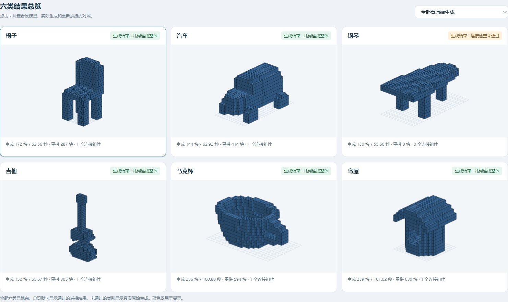

# 本地模型生成的六个 LEGO 样例

使用 [BrickGPT-Qwen3-1.7B-BrickMore-48](https://huggingface.co/Kyle308666/BrickGPT-Qwen3-1.7B-BrickMore-48) 在本地生成的真实保存结果，固定模型版本 `92d1c595f5fe076971cc2633d6844f097a84eef3`。每类仅生成一次，采用数据集原有 L1 英文描述，未输入参考几何；不是独立测试集或泛化成绩。

## 下载与查看

- **[下载全部六个样例及三维预览](BrickMore_LEGO_6_samples_20261020.zip?raw=true)**。
- 解压后运行 `python start_preview.py`，浏览器会打开本地三维预览；仅需 Python，无需安装模型权重。
- 下表的原始生成 LDR 可直接下载，用支持 LDraw 的查看器打开。配色为统一显示色，模型未输出颜色。
- `connected_geometry/model.ldr` 为额外重铺的最终单组件几何；保留原占用，不能代替模型的原始排砖序列。

| 样例 | 原始砖数 | 生成耗时（秒） | 原始生成 LDR | 最终重铺 LDR | 检查结果 |
|---|---:|---:|---|---|---|
| 椅子 | 172 | 62.56 | [下载](chair/generated.ldr) | [下载](chair/connected_geometry/model.ldr) | 最终单组件几何通过 |
| 汽车 | 144 | 62.92 | [下载](car/generated.ldr) | [下载](car/connected_geometry/model.ldr) | 最终单组件几何通过 |
| 钢琴 | 130 | 55.66 | [下载](piano/generated.ldr) | 未通过，原始结果仍保留 | 4 个重叠格，涉及原始记录 80、105、106 |
| 吉他 | 152 | 65.67 | [下载](guitar/generated.ldr) | [下载](guitar/connected_geometry/model.ldr) | 最终单组件几何通过 |
| 马克杯 | 256 | 100.88 | [下载](mug/generated.ldr) | [下载](mug/connected_geometry/model.ldr) | 最终单组件几何通过 |
| 鸟屋 | 239 | 101.02 | [下载](birdhouse/generated.ldr) | [下载](birdhouse/connected_geometry/model.ldr) | 最终单组件几何通过 |

## 结果预览

## 文件与来源

完整 ZIP 包含每类的 `generated_raw.txt`（原始输出）、`generation_report.json`、`source_prompt.json`、`dataset_original.json`、`generated_canonical.txt`、`generated_voxels.json`、新导出的 `generated.ldr`、原有严格检查草稿和最终重铺文件，以及 `manifest.json`、原验证记录和静态预览器。原有结果文件逐字节保留；新 LDR 按原始砖顺序导出并回读校对，没有用参考模型替代推理结果。

原始文本的第一尺寸按 Y、第二尺寸按 X 适配为标准 h 沿 X、w 沿 Y；这是既有输出诊断约定，尚未与训练转换脚本核对。三维占用 JSON 为 Y 向上；排砖与 LDR 转换的竖向坐标和尺寸约定见保存报告。预览用蓝色不是模型生成的颜色。

六次生成均正常结束，总耗时 448.71 秒。最终单组件几何检查为 5/6 通过，严格逐层下支撑检查为 0/6。钢琴的原始重叠与失败草稿均保留；几何通过不代表物理稳定性或实际安装顺序认证。

`upload_verification.json` 重新核对六类输入来源哈希、保存输出与报告、原始 LDR 回读，以及五个最终重铺的 TXT/LDR 回读、精确占用和真实单组件连接。`checksums.sha256` 提供 ZIP 内文件校验；`archive.sha256` 校验完整下载包。
