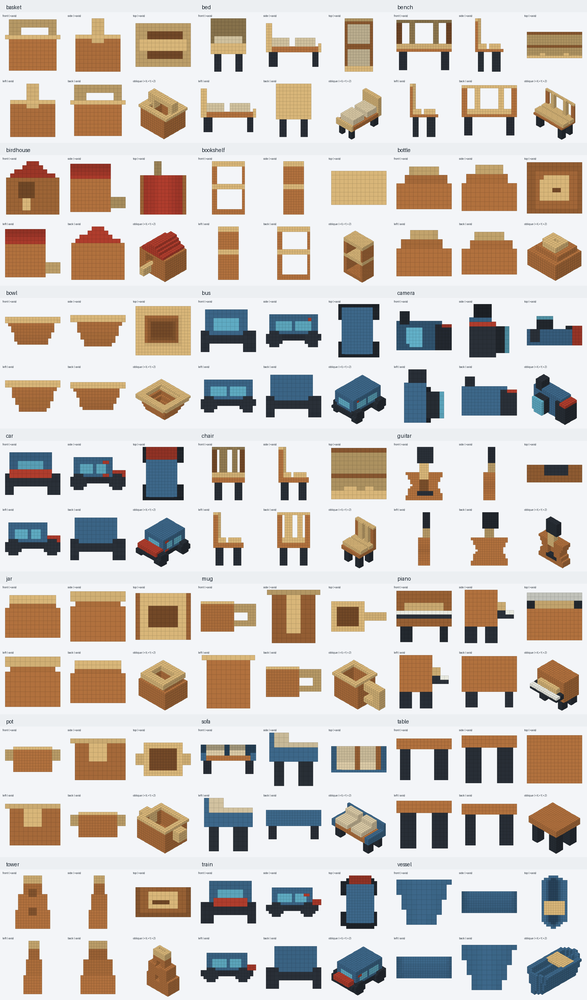

# AI_A + AI_B：80,000 个体素模型

两批各40,000个模型、200,000条中英双语记录；一模型的L1—L5描述关联同一份几何。原模型、颜色及原始模型ID均保留。仓库源码区包含统一模型索引、汇总报告和少量真实样例；**完整80,000个模型通过两个Release下载，不是仅上传样例或算法。**

| 分片 | 模型 | 双语记录 | 下载清单 |
|---|---:|---:|---|
| AI_A | 40,000 | 200,000 | [download_manifest.json](../download_manifest.json) |
| AI_B | 40,000 | 200,000 | [AI_B/download_manifest.json](AI_B/download_manifest.json) |
| 合计 | 80,000 | 400,000 | [dataset_catalog.json](../dataset_catalog.json) |

## 统一下载与合并

在仓库根目录运行，Python 3.11或更新版本：

```text
python tools/download_dataset.py --shard all --output dataset_80000 --extract
```

自动核对每个分包SHA-256，分别解压到 `dataset_80000/AI_A/` 和 `dataset_80000/AI_B/`，最后写出80,000模型的统一 `dataset_80000/manifest.json`。两批的全量提示词分别保存在 `AI_A/all_prompts.jsonl` 和 `AI_B/all_prompts.jsonl`；统一manifest中的 `sourcePromptFiles` 指向这两个文件，共400,000条记录，不复制五份模型。

只下载新增B分片：

```text
python tools/download_dataset.py --shard B --output dataset_B --extract
```

旧的无 `--shard` 命令仍只下载AI_A，保持兼容。目标目录出现不同内容的同名文件时会报错，不覆盖用户修改过的数据。每个模型均含 `model.json`、`model.npz`、`model.obj`、`model.mtl`、`model.vox`、`preview.png`、`validation.json`、`prompts.json` 八文件。

手动下载B时，将40个 `B_models_*.zip` 先解压，**最后再解压 `B_metadata.zip`**。原B分包带有各包1000模型的小索引，不可用它代替完整40,000索引。统一下载工具将这些小索引存到 `package_indexes/`，不会相互覆盖。不要将A/B的元数据直接解压到同一根目录。

## 索引和验收边界

[model_index.jsonl](model_index.jsonl) 每模型一行，路径相对于合并下载根目录；包含分片、模型ID、坐标占用hash、轴变换规范hash、模型及五级提示词位置。[merge_report.json](merge_report.json) 记录全量A/B索引碰撞与几何hash交叉检查。规范hash比较忽略颜色，涵盖轴置换、镜像和归一化平移。

本次全量交叉检查：80,000个模型ID唯一，原始占用hash和规范几何hash各80,000个唯一，A/B重复数量均为0。

两个归档的400,000条实际提示词已完整读取，记录ID无碰撞，每模型五级齐全、种子/目标几何hash/源路径一致。利用AI_A元数据中55,255条历史索引补充原始占用hash检查，无重叠；旧完整坐标仍缺失，不把该结果扩展成历史旋转/镜像或近形无重复证明。

提示词记录中的模型路径相对于各自的AI_A/AI_B分片根目录；跨批使用时可按 `modelId` 查询统一模型索引，以其 `modelJsonPath` 定位模型。

原归档中旧的 `awaiting_merge` 状态是生成时快照，未通过修改模型元数据伪造新验收；此次合并的实际结果以单独merge_report为准。跨批近形筛查及历史完整坐标去重不因上传而完成。

AI_B只有3,288个模型在当前砖库与支撑规则下完成几何LEGO装配，其余模型仍作为原始体素数据完整保留。80,000模型不表示80,000个物理稳定的LEGO模型。算法和失败分类见 [拼接算法](../algorithms/voxel_assembly_b/README.md)。



本地合并发布工具：`tools/merge_shards.py`（只读源数据、生成索引与发布清单）、`tools/github_release.py`（校验后上传、不覆盖已有不同资产）。发布所用Git凭据只留在进程内存中，不进入仓库。
